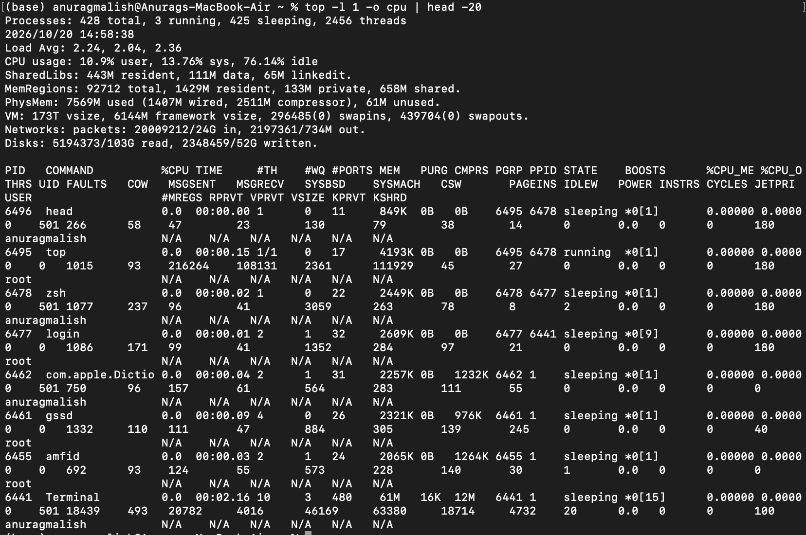
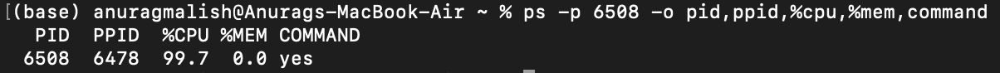
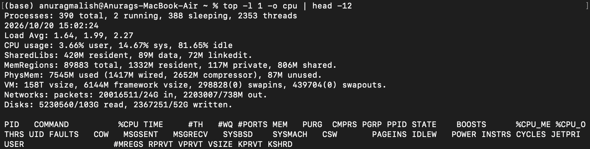

# Ticket #005 — Slow Mac / High CPU Usage

## Ticket Information

- **Category:** System Performance / CPU Troubleshooting
- **Priority:** Medium
- **Status:** Resolved
- **Environment:** macOS
- **Type:** Simulated Help Desk Lab

## User Report

"My Mac is running slowly, and applications are taking longer than usual to respond."

## Lab Scenario

Simulated a high-CPU performance incident by launching a controlled background process using `yes > /dev/null &`. Investigated the process, identified excessive CPU consumption, terminated the process, and verified that CPU capacity recovered.

## Troubleshooting Steps

### 1. Establish Baseline CPU Usage

Executed:

```bash
top -l 1 -o cpu | head -20
```

Observed 76.14% CPU idle before starting the simulated workload.

### 2. Reproduce the Performance Issue

Started a background process:

```bash
yes > /dev/null &
```

The process was assigned PID 6508.

### 3. Identify the High-CPU Process

Executed:

```bash
ps -p 6508 -o pid,ppid,%cpu,%mem,command
```

Identified the `yes` process consuming 99.7% CPU, approximately one CPU core, with negligible memory usage.

### 4. Terminate the Problematic Process

Executed:

```bash
kill 6508
```

Terminal confirmed the background job was terminated.

### 5. Verify Resolution

Executed:

```bash
ps -p 6508 -o pid,%cpu,%mem,command
```

Confirmed no process was returned for PID 6508.

Rechecked system CPU usage:

```bash
top -l 1 -o cpu | head -12
```

Observed 81.65% CPU idle following termination.

## Root Cause

A deliberately launched background process was continuously consuming approximately one CPU core, creating a simulated high-CPU performance issue.

## Resolution

Identified the resource-intensive process using `ps` and terminated it using `kill`. Verified the process had exited and that overall CPU availability remained high.

## Evidence

### CPU Baseline

Initial CPU snapshot showing 76.14% idle capacity.



### High CPU Diagnosis

Identified PID 6508 (`yes`) consuming 99.7% CPU.



### Process Termination

Terminated the identified process and received confirmation from Terminal.


### CPU Recovery Verification

Confirmed process termination and observed 81.65% CPU idle after resolution.



## Skills Demonstrated

- macOS performance troubleshooting
- CPU utilisation analysis
- Process identification and management
- Command-line diagnostics using `top` and `ps`
- Targeted process termination using `kill`
- Root cause analysis
- Incident documentation
- Resolution verification
